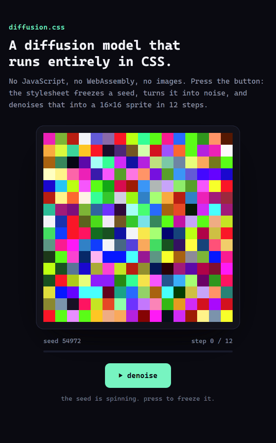

# diffusion.css

**[Try it: metrix187.github.io/diffusion.css](https://metrix187.github.io/diffusion.css/)**



A denoising diffusion model that runs in a stylesheet. Open `index.html`, press the button, and the
CSS turns a random seed into noise and denoises it into a 16×16 pixel-art sprite. The page has no
`<script>`, no event handlers, no images and makes no network requests.

| | |
|---|---|
| Weights (non-zero, biases included) | 202,863 |
| Networks | 11, one per noise level |
| Sampler steps | 12, deterministic DDIM |
| Registers | 12,518 `@property` `<integer>` |
| Possible seeds | 15,813,251 |
| File size | 5.2 MB (0.76 MB gzipped) |
| Time to compute a sprite | about 0.13 s in Chromium 152 on a desktop PC |

`samples.png` shows 80 results from the integer sampler and `trajectory.png` one full denoising run.
`demo.gif` and `demo.mp4` are recordings of the real page in headless Chrome (one sprite), and
`demo_3x.mp4` shows three in a row. `record.py` made them by pressing the page's own button.

## Run it

Use the [hosted copy](https://metrix187.github.io/diffusion.css/), or open `index.html` in a browser.
It is one self-contained file, so double-clicking it works; so does any static host.

## How it works

**Seed.** `--seed` is an `@property` integer that a keyframe animation counts from 0 to 15,813,250.
A hidden checkbox pauses that animation (`.app:has(#go:checked)`), so the moment you press is the
seed. Three more registers split it into base-251 digits.

**Noise.** Each of the 768 pixel channels (16 × 16 × RGB) has a register that hashes those digits
with `mod()` four times and sums the draws (an Irwin-Hall approximation to a Gaussian). This is the
static you see before pressing, and it is `x_T` for the sampler.

**Model.** One small MLP per noise level, each predicting the clean image from a noisy one:

```
per colour channel:  256 pixels -> 12 units        (ReLU)
all channels:        36 -> 64 -> 60                (ReLU, fully connected)
per colour channel:  20 units -> 256 pixels
```

They are trained in PyTorch (`train.py`) on ten hand-drawn sprites (`sprites.py`), each recoloured
to a random hue for every sample, then pruned and rounded to integers (`quant.py`). The first
sampler step needs no network: from pure noise the best guess is the dataset mean.

**Sampling.** Deterministic DDIM, unrolled. CSS has no loop, so every step gets its own copy of
the arithmetic and every intermediate value its own `@property` `<integer>` register. A hidden unit
looks like this in the stylesheet (the first unit of the network used by step 2):

```css
--Ba0: max(0, (51096.5 + 25*var(--a108) - 26*var(--a123) - 31*var(--a126) ... 80 more terms)/512);
```

The network rule only matches while the checkbox is ticked, so nothing is computed until the seed
is frozen.

**Timeline.** One `@keyframes` rule points 768 "view" registers at each sampler state in turn, and
the 256 pixel elements read those. The filmstrip under the button draws all 13 states with
`box-shadow`.

**Exactness.** Everything is fixed-point integer arithmetic. Every division is by a power of two
with 0.5 added to the numerator, so a quotient is never an exact tie and rounding does not depend on
the browser's tie rule. Across 30,000 sampled seeds the largest sum of absolute terms in any one
`calc()` was 3.66 million. An engine that evaluates `calc()` in 32-bit floats stays exact below 2^23
(8.39 million), so that is a measured margin of about 2x, not a proof for every seed.

## Check it yourself

```
python verify.py model.pt 40
python -m http.server 8765
```

Open `http://localhost:8765/index.html` and paste `verify_snippet.js` into the DevTools console. It
pins `--seed` from outside, reads the 768 final registers back and compares them with the Python
integer sampler. The snippet is a test harness; the page stays script-free.

`python export.py model.pt --eval SEED` prints the reference checksum of every sampler state for
one seed, and `--png SEED` saves the trajectory as an image.

## Rebuild it

```
python -m venv .venv
.venv/Scripts/python -m pip install numpy pillow
.venv/Scripts/python -m pip install torch --index-url https://download.pytorch.org/whl/cpu
.venv/Scripts/python train.py out=model.pt iters=24000 sp_in=0.5 sp_mid=0.4 sp_out=0.45 fq=1   # 10-20 min on CPU
.venv/Scripts/python evalq.py model.pt      # integer sampler vs float sampler, size, safety margins
.venv/Scripts/python export.py model.pt     # writes index.html (add site=... repo=... for link tags)
```

## Files

| File | What it is |
|---|---|
| `index.html` | The page. This is the only file you need to host. |
| `sprites.py` | The ten sprites, the recolouring, and the "how far from a valid sprite" score. |
| `model.py` | Noise schedule, the per-level MLPs, the float DDIM sampler. |
| `train.py` | Training, gradual pruning, quantisation-aware fine-tuning. |
| `quant.py` | Float weights to integers; the integer sampler; the register graph. |
| `cssgen.py` | Register graph to CSS, the seed-to-noise hash, exact evaluation. |
| `page.py` | Assembles the HTML and CSS. |
| `export.py`, `evalq.py`, `verify.py`, `verify_snippet.js` | Build, score, and check. |
| `model.pt` | The trained checkpoint `index.html` was built from. |
| `preview.py` | Draws `preview.png`, the link-preview card, from the integer sampler's output. |
| `record.py` | Records the demo: headless Chrome, real clicks, 2x screenshots, ffmpeg. Needs `pip install playwright`, Chrome and ffmpeg. Retries until the sprite is clean, and checks every take against the reference. |

## What it is not

- **Not a loop.** The sampler is unrolled, so the stylesheet contains one copy of the arithmetic per
  step. The animation reveals states that were all computed when the seed froze; it does not drive
  the computation.
- **Not a creative model.** It learned ten shapes and a continuous range of colours. A new seed
  gives a new shape-and-colour combination, never a new shape.
- **Not flawless.** Across 30,000 seeds, about 5% of results are muddled: a blend of two sprites, or a
  washed-out colour.
- **Not tested outside Chromium.** It uses only features that current Chrome, Firefox and Safari
  all ship (`@property`, `:has()`, `mod()`, `clamp()`), and the arithmetic is designed to be
  engine-independent, but it has only been run in two Chromium builds: Chromium 152 and Chrome 157
  (headless, while recording the demo).

## Related work

- [Implementing GPT-2 Entirely In CSS](https://shubhampatil.dev/blog/gpt2-css), Shubham Patil
- [css-ml](https://github.com/mickael-btc/css-ml), mickael-btc: classifiers and a VAE decoder in CSS;
  the integer-register approach here follows the one described in its README
- [x86CSS](https://lyra.horse/x86css/), Lyra Rebane

## License

MIT. See `LICENSE`.
